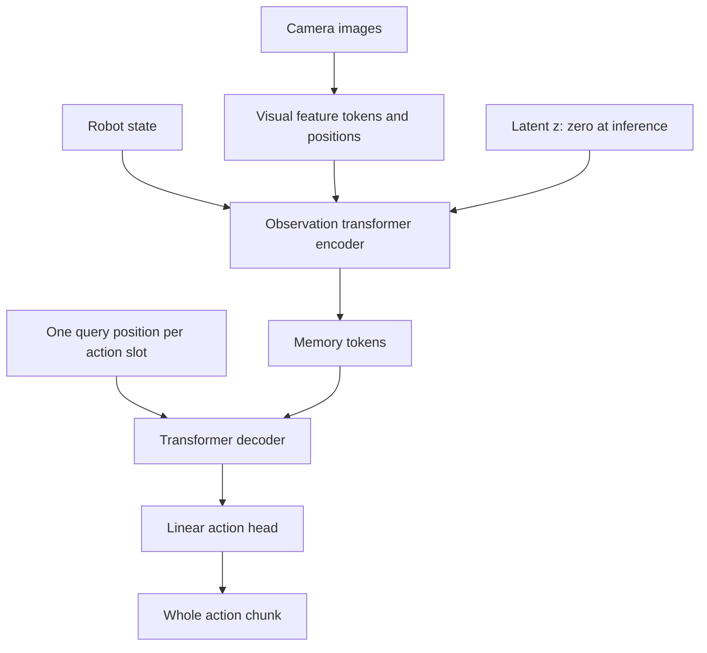
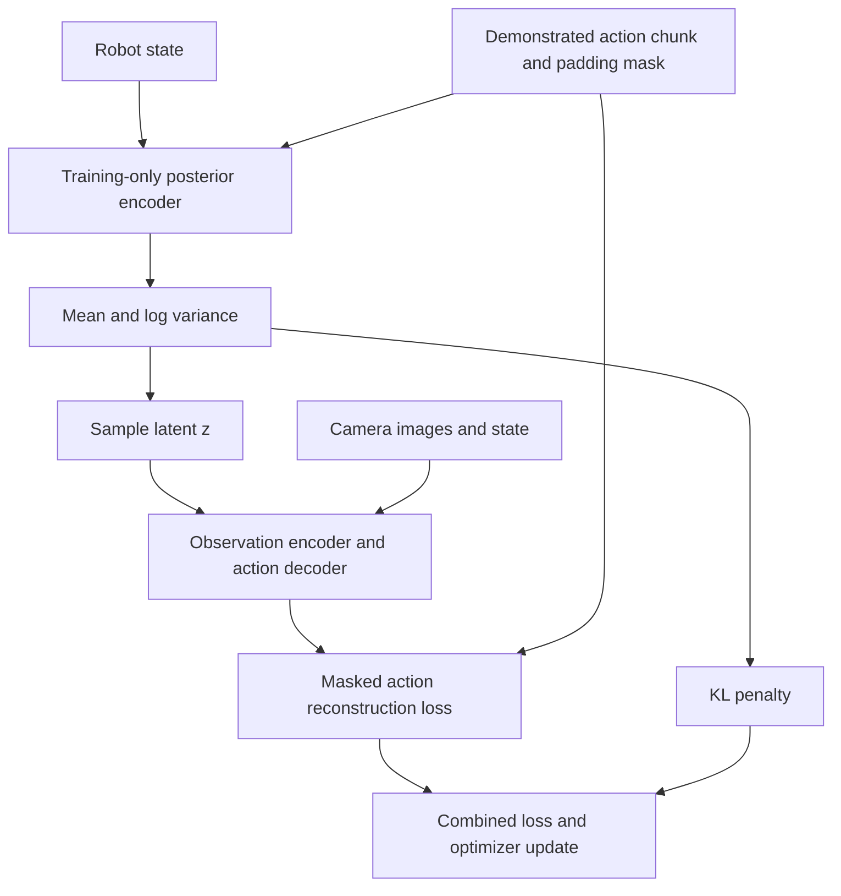

# ACT: predict a coordinated action chunk

[Concept guides](README.md) · [Control background](control-and-learning.md) · [Start Lesson 2](../02-act-execution/02-act-execution.ipynb)

## Why this method exists

A robot can make a small error on every step. Its next observation then differs from the demonstration, and errors can accumulate. Action Chunking with Transformers (ACT) learns several related actions together. It also has a training mechanism for variation between demonstrations, such as different ways to approach the same object. These are central ideas of the [ACT paper](https://arxiv.org/abs/2304.13705).

In this course, ACT receives camera images and robot state and predicts a chunk of relative controller commands. It does not receive a language instruction. The task is learned through the selected training data and checkpoint. The course's execution loop chooses a prefix of the chunk; the original method also discusses temporal aggregation of overlapping predictions, which is a separate execution choice.

## Follow one prediction

Imagine that the gripper is near the bowl. Visual features describe the scene. State values locate the gripper. The model combines them into a sequence of feature vectors called **tokens**. A transformer encoder lets these tokens exchange information. Its output is called **memory**.

The decoder has one query position for each action slot. Each query reads the memory and returns a feature vector. A final linear layer, the **action head**, converts that vector into seven action values. All slots are predicted together. ACT does not generate the next slot by feeding the previous predicted action back as a language model feeds back a generated word.

The diagram is the inference path. The latent input is explained next. The surrounding processors and controller still come from the control guide.

## Why a latent variable appears during training

Two demonstrations can start from similar observations but use different valid motions. A **latent variable** is a learned internal representation of such variation. ACT trains a **conditional variational autoencoder**, or CVAE. “Conditional” means that its prediction depends on an observation. “Variational” refers to how it learns a probability distribution for the latent variable.

During training, a posterior encoder reads robot state and the demonstrated action chunk. It produces a mean and log variance. A sampled latent vector then helps the action predictor reconstruct that chunk. A **KL penalty** keeps the learned latent distribution close to a standard normal distribution. Without this constraint, the training path could rely too strongly on latent information obtained from future actions.

At inference, future actions do not exist. This ACT implementation uses `z = 0` and bypasses the posterior encoder. Zero is the center of the latent prior; it does not mean that all commands must be zero. The images, state, decoder, and action head still determine the output. A generic CVAE can sample its prior; the zero-latent path is the specific ACT choice taught here.

Lesson 5 first uses a small CVAE to make this idea visible. Lesson 8 builds the ACT posterior with state and action tokens. The small CVAE is a teaching model, not the complete camera policy.

## What attention contributes

A token is a vector, not necessarily a word. An image-grid cell, the robot state, and an action query can each be represented as tokens.

- A **query** specifies what information a token requests.
- A **key** helps other tokens decide whether to read it.
- A **value** contains the information to combine.
- **Self-attention** combines tokens within one sequence.
- **Cross-attention** lets decoder queries read encoder memory.

For a grasp, a decoder query might need information from a bowl-region feature and the state token. Attention computes learned weights for those inputs. This example explains a possible role; an attention weight alone does not prove that a model detected a bowl or reasoned about a grasp.

Position encodings identify where an image feature or action slot belongs. Without position information, equal-looking tokens would not identify different locations or times. Padding masks instead identify absent tokens. Position and validity solve different problems.

## Where each lesson fits

| Lesson | Component you work on | Why it matters |
| --- | --- | --- |
| [2: execution](../02-act-execution/02-act-execution.ipynb) | Processor, prediction, prefix execution, stopping | Connect a supplied policy to the controller. |
| [3: data](../03-act-data/03-act-data.ipynb) | Training statistics, windows, masks | Give the model correctly paired inputs and targets. |
| [4: training](../04-act-training/04-act-training.ipynb) | Action loss, KL term, optimizer updates | Turn demonstrations into weight changes. |
| [5: CVAE](../05-act-cvae/05-act-cvae.ipynb) | Posterior, sample, conditional decoder | Understand training-only latent information. |
| [6: attention](../06-act-attention/06-act-attention.ipynb) | Attention and encoder layer | Combine information across tokens. |
| [7: decoder](../07-act-decoder/07-act-decoder.ipynb) | Action queries and cross-attention | Read scene memory for each action slot. |
| [8: assembly](../08-act-assembly/08-act-assembly.ipynb) | Complete ACT model path | Join the parts and compare against supplied weights. |
| [9: adaptation](../09-act-adaptation/09-act-adaptation.ipynb) | Bounded fine-tuning, save, reload, evaluation | Test whether changed weights improve useful behavior. |

## Check your understanding

Why can the posterior read target actions without leaking them at deployment? It is a training-only component. Deployment uses the zero latent and the current observation.

Does matching a supplied model's outputs establish task success? It establishes implementation parity on the checked inputs. The checkpoint still needs rollout evaluation.

For the implementation used by the lessons, see [act_model.py](../../src/vla_lab/teaching/act_model.py), [attention.py](../../src/vla_lab/teaching/attention.py), and [cvae.py](../../src/vla_lab/teaching/cvae.py).
