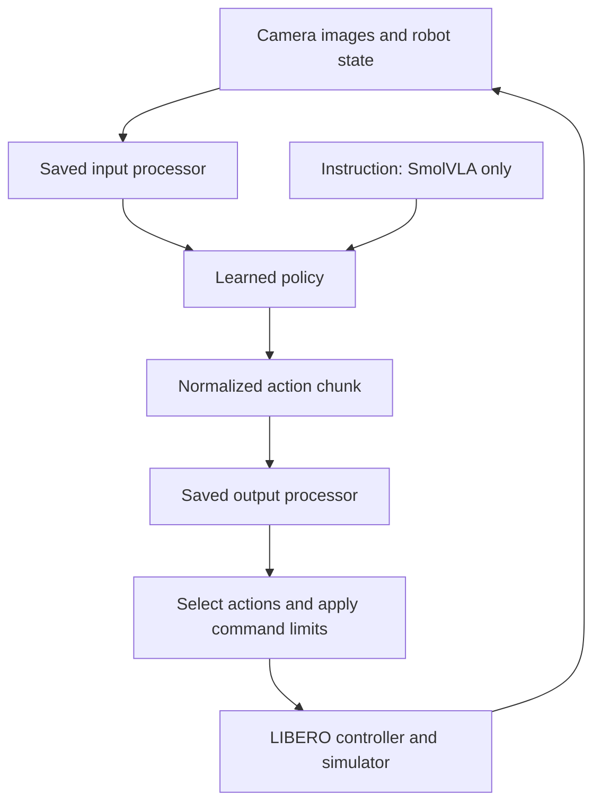
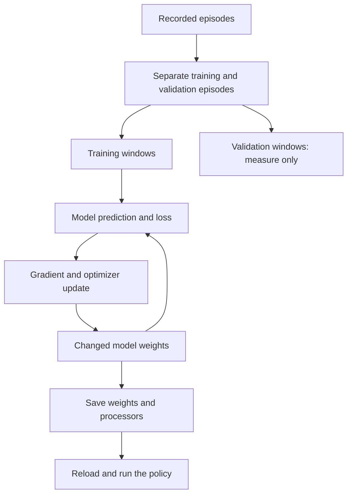

# From demonstrations to robot control

[Concept guides](README.md) · [Start Lesson 1](../01-playground/01-playground.ipynb)

## The problem: choose a useful action from an observation

Suppose a robot must put a bowl on a plate. A camera image contains the bowl and plate, but it does not specify which controller command to send. The robot also needs its current state, such as the end-effector position and gripper position. An **observation** is the information available at this instant. It is only a partial view of the world: objects can be hidden, and one image does not show motion.

A **policy** maps observations to actions. An action in this course has seven values: three relative translation commands, three relative rotation commands, and one gripper command. These are inputs to the LIBERO controller. They are not seven joint angles or absolute target coordinates. The supplied controller and simulator convert the command into motion.

The policy must choose actions repeatedly. A **rollout** is the sequence of observations and actions produced when the policy runs. An **episode** is one attempt from a reset until a stop condition.

Read the loop from left to right. The policy predicts commands; the controller applies them. The next observation closes the loop. Each policy has its own saved processors. Do not exchange processors between checkpoints just because the array shapes match.

## How demonstrations become a policy

A **demonstration** records what a demonstrator saw and what they did. **Imitation learning** trains a policy to reproduce these actions. **Behavior cloning** treats this as supervised learning: an observation is the input, and demonstrated actions supply the target.

For the bowl task, one training row can contain the cameras and state before a reach, with the next several demonstrated commands as its target. The target is available during training because it was recorded. At deployment, the policy must produce actions from current observations without those future demonstrations.

A **loss** measures a training error. An **optimizer** uses gradients of that loss to change model weights. A **checkpoint** stores weights. A usable policy bundle also needs its configuration and processors. Evaluation computes results with fixed weights; it does not call an optimizer.

These lessons use imitation losses. Simulator rewards and success flags are used to evaluate behavior. They are not the training target of a reinforcement-learning loop here.

## Why predict more than one action?

A reach contains related movements. Predicting an **action chunk** lets the model represent several of them together. For one environment, a chunk with shape `(1, 20, 7)` contains 20 action slots, each with seven command values. The first axis is the batch axis, not another time axis.

The controller can use a prefix of the chunk, then ask for a new prediction. This is **receding-horizon control**: plan ahead, execute part, observe again, and replan. A shorter prefix permits more frequent corrections but needs more model calls. A longer prefix reduces calls but acts for longer without a new prediction. It can become inaccurate if the object moves.

| Example at 20 Hz | What happens |
| --- | --- |
| Predict 20 actions; execute 5 | One prediction supplies at most 0.25 seconds of commands. |
| Receive observations during those 5 steps | The environment reports new state, but the queued actions remain the same. |
| Finish the prefix | Predict again from the latest available observation or history. |
| Success or another stop condition occurs early | Stop before the remaining queued actions run. |

Chunk prediction is not an explicit search through a physics model. These policies learn action sequences from examples. The supplied simulator applies each selected relative action once at 20 Hz. A dataset's 10 FPS storage label does not tell the controller to repeat an action.

## Three policies, three ways to produce a chunk

| Method in this course | Condition: information used to choose actions | How it produces a chunk |
| --- | --- | --- |
| ACT | Current camera images and robot state | A transformer predicts all action slots in one forward pass. |
| Diffusion Policy | Recent camera images and state history | A network and noise scheduler repeatedly update a noisy action window. |
| SmolVLA | Images, state, and task instruction | A vision-language model supplies context; an action expert repeatedly updates a noisy chunk with flow velocity. |

ACT and Diffusion Policy are independent policies in this course. Neither needs a SmolVLA output. SmolVLA has its own action generator. The word **generative** means that a model can represent and produce possible outputs, including action sequences; it does not require generated text or images.

## Four boundaries to check

1. **Data to model.** Match camera order, state order, image scale, and the saved normalization. Normalization changes numerical scale; it does not change the meaning of a channel.
2. **Model to controller.** Convert normalized predictions back to controller values before command clipping. Clipping limits a number; it cannot correct a wrong channel order.
3. **Training to inference.** Remove information that exists only in demonstrations, such as ACT's future-action posterior input.
4. **Prediction to evidence.** A plausible action tensor is not a successful task. Run the policy and record what the environment reports.

A padding mask identifies absent targets near an episode end. It does not mean that the robot should execute zero commands there. The loss uses the mask to exclude targets that were never recorded.

## Check your understanding

If a policy predicts 20 actions but executes five, how many new predictions are needed for 20 controller steps, assuming no early stop? Four. The unused suffix of each prediction is replaced after new observations arrive.

If validation loss falls, has the bowl task been solved? Not yet. Validation measures imitation on recorded inputs. A rollout tests the states the policy reaches through its own actions.

Continue with [ACT](act.md), [Diffusion Policy](diffusion-policy.md), or [SmolVLA](smolvla.md). The exact execution helpers are in [runtime.py](../../src/vla_lab/teaching/runtime.py); the simulator interface is in [episode.py](../../src/vla_lab/sim/episode.py).
