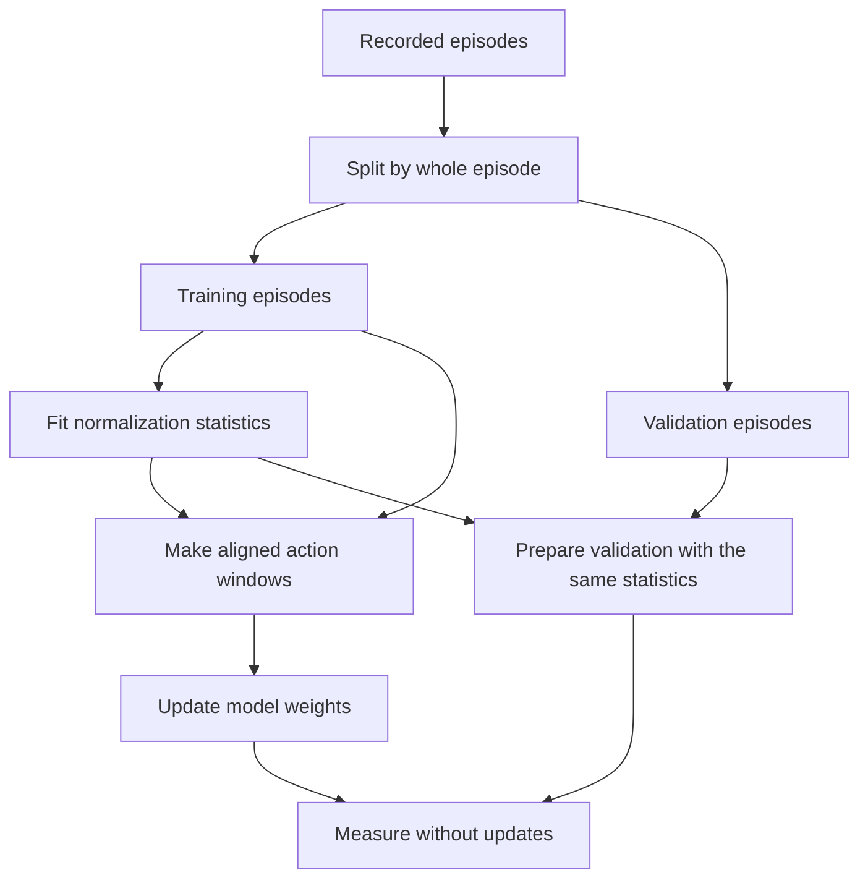
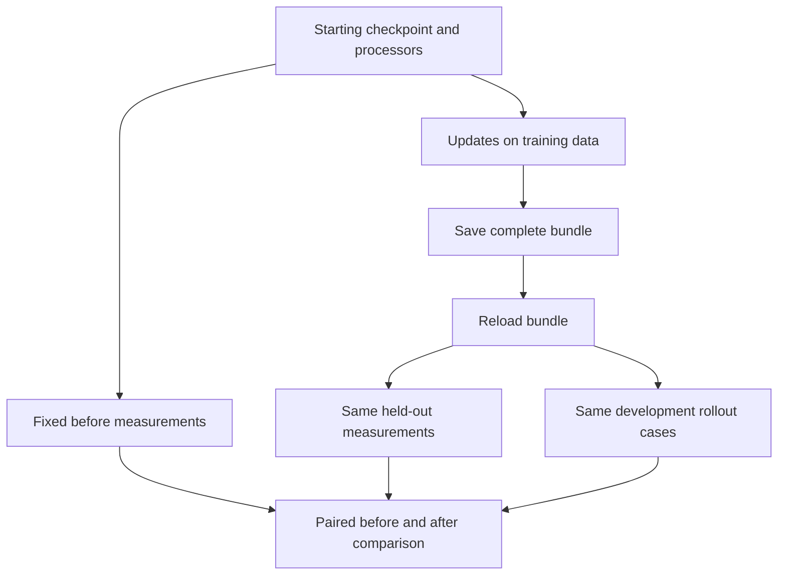
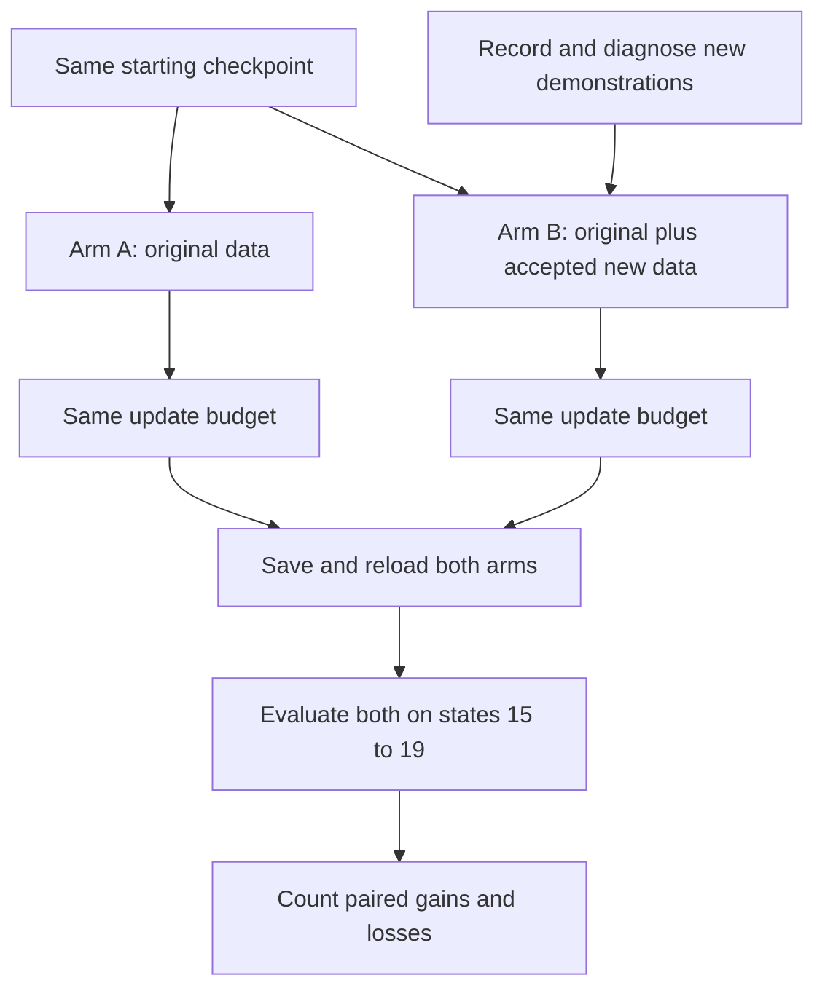

# Data, adaptation, and evidence

[Concept guides](README.md) · [Control background](control-and-learning.md)

## The problem: a lower loss can hide the wrong lesson

Suppose an image of an open gripper is paired with an action from a later frame. A model can reduce its loss by learning this incorrect pairing. More training will not restore the missing timing information. Before choosing a larger model or more updates, check what each demonstration row means.

In this course, a transition pairs an observation before a controller step with the action applied during that step. A training window contains consecutive actions from one episode. If the episode ends before the window does, padding fills the array and a mask identifies the absent targets.

Fit normalization on training episodes only. Nearby frames from one episode can look almost identical. Splitting those frames between training and validation can make validation easier without testing a new demonstration. Simulator initial-state splits are a separate boundary from demonstration-episode splits.

## What adaptation means

**Pretraining** supplies weights learned before this experiment. **Fine-tuning** continues training from those weights. **Adaptation** describes the intended change: improve the policy for the target task or data. A fine-tuning run can fail to produce useful adaptation.

ACT predicts actions and uses its reconstruction and latent losses. Diffusion predicts added noise. SmolVLA predicts flow velocity. All three can use demonstrations, but their loss values have different meanings. Compare a method's before and after loss on the same examples and settings. Do not compare a diffusion loss of 0.1 with an ACT loss of 0.2 and declare diffusion better.

For noisy objectives, use fixed noise and time samples when you want to isolate the effect of changed weights. A reload check verifies that the saved result reproduces the model you measured. A small successful update proves that the update path works; it does not establish useful robot learning.

## Why rollout evaluation adds information

A validation window begins at a recorded state. In a rollout, the policy's own actions determine its next state. A small early error can lead to a scene that the demonstrations did not cover. This change in the input distribution explains why low imitation error and high task success are related but different outcomes.

| Evidence | What it can establish | What it cannot establish alone |
| --- | --- | --- |
| Function check | The checked inputs produce the expected result | Full policy behavior |
| Parity check | Two implementations agree under the checked conditions | A useful checkpoint |
| Parameter-change check | An update changed permitted weights | Improved task performance |
| Held-out loss | Error on separate recorded examples | Behavior after the policy's own mistakes |
| Simulator rollout | Outcome in a stated task, state, and seed | General reliability on new tasks or real hardware |

Task success is the environment's `is_success` signal. An episode can terminate or reach a time limit without success. Preserve failed attempts and errors in the report so the denominator remains clear.

## Test one data change at a time

Lesson 21 compares an original-data training arm with an original-plus-new-data arm. Both start from the same checkpoint and use the stated update budget. This isolates the data intervention more clearly than comparing unrelated runs.

If arm B succeeds on a case where arm A failed, that is a gain. The reverse is a loss. Report both. A larger net count on five cases is a small experiment, not a broad ranking of data strategies.

## Freeze choices before final comparison

Use exploration states 0–9 to learn the system. Use states 10–14 for method checks and states 15–19 for the data intervention. Reserve states 20–49 for final evaluation after the recipe is fixed. A **recipe** includes the checkpoint, processors, execution settings, task, seeds, and limits.

A paired comparison runs methods on the same cases. Pairing reduces the chance that a difference only reflects different starting conditions. An uncertainty interval shows how limited the sample is. The sign test in Lesson 22 examines cases where outcomes differ. It does not explain why they differ.

Training budgets and prior weights still matter. Equal adaptation updates do not imply equal total training, equal wall time, or equal prior knowledge. Report those differences with the outcomes.

## Speed has more than one clock

At 20 Hz, a controller tick lasts 50 ms. A model call generates a chunk and can take longer than one tick. A queue may make several later action selections cheap, while the refill call is expensive. Report the latency distribution, including its tail, rather than only the mean.

| Quantity | Meaning |
| --- | --- |
| Simulated time | Number of controller ticks divided by 20 |
| Model-call wall time | Real time spent in one measured policy call |
| Episode wall time | Real time for the whole rollout, including simulator work |

The course simulator waits while the policy computes. A slow call therefore does not, by itself, simulate a physical robot moving with stale actions. Lesson 22 estimates timing constraints for other execution designs; it does not demonstrate an asynchronous real-robot controller.

## Lesson map and reading check

Lessons 3–4 establish data and updates. Lessons 9, 15, and 20 apply adaptation to each method. Lesson 21 tests a data change. Lesson 22 compares complete recipes.

Before you interpret a result, name its input data, changed component, fixed conditions, and measured output. If you changed the data, checkpoint, and action prefix together, you cannot attribute the difference to the data alone.

See the [recording operations](../../src/vla_lab/teaching/recording.py), [comparison operations](../../src/vla_lab/teaching/course_comparison.py), and [course instructions](../README.md) for the exact experiment boundaries.
