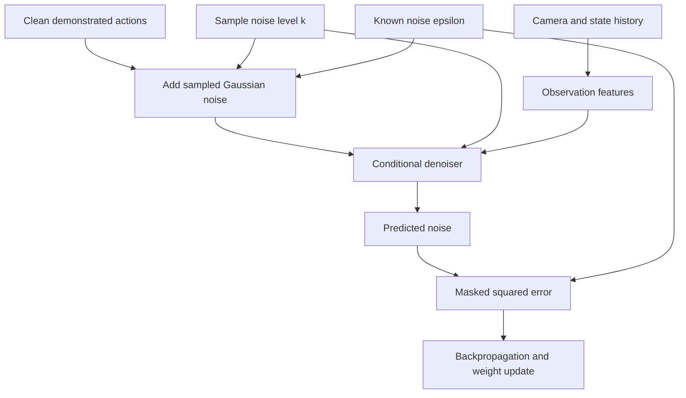
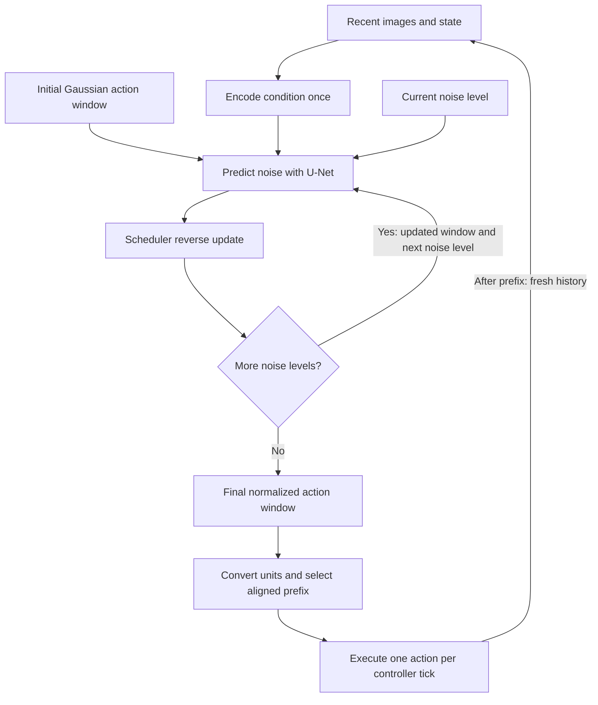
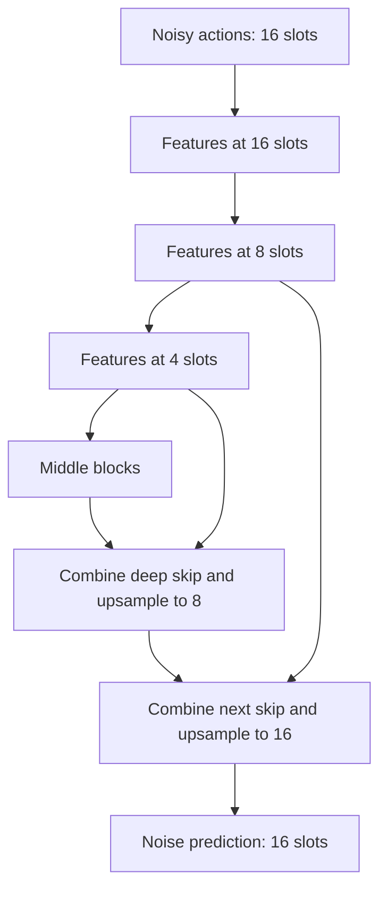
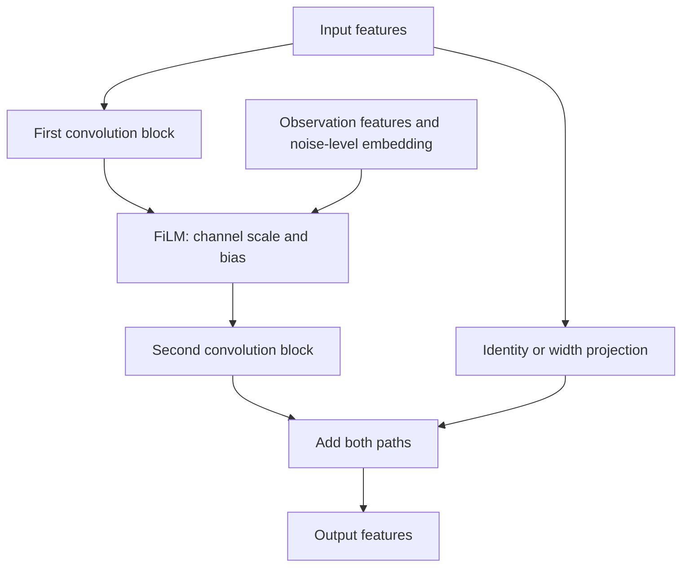

# Diffusion Policy: generate actions from noise

[Concept guides](README.md) · [Control background](control-and-learning.md) · [Start Lesson 10](../10-diffusion-execution/10-diffusion-execution.ipynb)

## Where diffusion sits in the control system

**Diffusion Policy is the action policy in Lessons 10–15.** It takes recent camera images and robot state, and generates an action window. It does not take candidate actions from ACT or SmolVLA. The object that it denoises is an array of action values, not an image.

Thus, the course policy maps observations to actions directly, with a learned image encoder, a conditional denoiser, and a sampling procedure inside that mapping. “End to end” can describe this observation-to-action learning path; it does not mean one network call, motor-torque output, or the removal of input processors and the controller. The small exercises sometimes use state-only conditions to isolate an operation. The prepared visual policy uses camera features as well.

Diffusion is a general generation method. Other systems can place a diffusion action head inside a VLA or condition it on another model's features. That is a possible architecture, not the connection used between the three policies in this course. SmolVLA's action expert uses the related but different flow-matching objective described in [its guide](smolvla.md).

## Why start with random actions?

Suppose demonstrations reach around an obstacle on either side. Both routes can work. An average of the routes could go through the obstacle. A **multimodal distribution** has several distinct groups of likely outputs. A conditional generative policy can represent more than one plausible action sequence for the same observation. This is one motivation for [Diffusion Policy](https://diffusion-policy.cs.columbia.edu/).

Starting from random noise gives the sampler a starting point from which to generate a sequence. The learned denoiser and the observation condition shape that sequence. Random noise alone contains no knowledge of the task. The initial noise is never sent to the robot.

This is not a guarantee of collision avoidance. The model learns patterns from demonstrations; the sampler does not test candidate trajectories with a collision checker in these lessons.

## Two processes: corrupt during training, generate during inference

During training, we have a clean demonstrated action window. We deliberately add a known amount of Gaussian noise. The network sees that noisy window, the noise level, and the observation. It learns to predict the noise that was added. The known noise supplies a supervised target even though no human labeled a denoising direction. This follows the noise-prediction formulation of [DDPM](https://arxiv.org/abs/2006.11239).

Training usually samples one noise level per example. A closed-form expression creates the noisy window at that level directly. One optimizer update does not need to run all reverse sampling steps.

During inference, we have observations but no demonstrated future actions. Start with a Gaussian action-shaped array. Repeatedly predict noise and apply the scheduler's reverse update. The weights remain fixed throughout this loop.

The denoiser predicts noise. The **scheduler** converts that estimate into the next action-window estimate. The **sampler** runs the complete sequence of denoiser and scheduler calls. These names refer to different components.

## A small numerical example

Write the forward noising relation as:

$$x_k=\sqrt{\bar\alpha_k}\,a+\sqrt{1-\bar\alpha_k}\,\varepsilon.$$

Here, `a` is a clean normalized action window; `epsilon` is standard Gaussian noise of the same shape. `alpha_bar[k]` specifies how much signal remains at noise level `k`. The square roots control the signal and noise scales. The actual notebook tensors have shape `(batch, horizon, action_width)`.

For one illustrative scalar, let `a = 0.8`, `epsilon = -0.4`, and `alpha_bar = 0.25`. Then `x = 0.5 × 0.8 + sqrt(0.75) × (-0.4)`, about `0.054`. The network must predict `-0.4`, the noise, rather than `0.8`, the clean action. The observation tells the network which kinds of clean actions are plausible.

If the noise estimate were exact, the clean-sample estimate `(x - sqrt(1-alpha_bar) × epsilon) / sqrt(alpha_bar)` would recover `0.8`. A real DDPM reverse step then uses schedule-dependent coefficients and, except at the final step, a noise term. Simply subtracting the predicted noise is not the DDPM update. Lesson 14 derives the complete update, including skipped noise levels.

## Keep the time axes separate

The same word “step” can refer to three different things:

| Axis | Meaning | Example in the prepared diffusion recipe |
| --- | --- | --- |
| Observation history | Past information used for one prediction | 2 observations |
| Action horizon | Slots in one predicted action window | 16 slots, each with 7 command values |
| Noise schedule | Levels of corruption or reverse updates inside one prediction | 100 training noise levels; the sampling schedule can use fewer |

Controller time is another count: each executed action advances LIBERO by one 0.05-second tick. Twenty denoiser calls do not mean twenty robot movements. They update the same action window before it is used.

For `n_obs_steps = 2`, the predicted window is aligned from the older observation. Slot 0 aligns with the older observation, and slot 1 with the newest observation. With `n_action_steps = 8`, the controller queue receives slots 1 through 8. Slot 0 is not sent as the next command. Slots 9 through 15 are the unused suffix. After eight commands, the policy samples again from the latest history.

| Window slot | 0 | 1 | 2–8 | 9–15 |
| --- | --- | --- | --- | --- |
| Role | Older alignment | Current command | Next seven commands | Unused suffix |
| Execute now? | No | Yes | In order | No |

This alignment explains why Lesson 10 teaches a queue before opening the neural network. A correct denoiser with the wrong action slice still sends the wrong commands.

## What the U-Net does

The denoiser is a **temporal U-Net**. “Temporal” means that its convolutions run along the action-window axis. It is not an image U-Net that generates a camera frame. It reduces the sequence length to combine information over larger portions of the motion, then increases the length again. **Skip connections** carry features from earlier stages into later stages so that local details remain available.

This diagram shows the three-stage layout used in the lesson example. The pinned implementation consumes the two deeper skip features; it does not add an extra decoder stage for the first full-length feature. Follow Lesson 13's channel table for exact widths.

Every residual block also needs to know the noise level and the observation condition. A timestep embedding converts the integer noise level into a feature vector. **FiLM**, feature-wise linear modulation, uses the condition to set a scale and bias for each feature channel. It changes how the same noisy action is processed for different scenes.

The residual path preserves an input route while the learned branch adds a change. FiLM is conditioning within one denoiser pass. It is not the reverse diffusion update. The same trained U-Net is reused at every sampling level; it is not one separately trained network per level.

## Where each lesson fits

| Lesson | Part of the system | What is supplied while you learn this part |
| --- | --- | --- |
| [10: execution](../10-diffusion-execution/10-diffusion-execution.ipynb) | Choose the aligned prefix and consume the queue | Trained policy and sampler |
| [11: training](../11-diffusion-training/11-diffusion-training.ipynb) | Construct noisy targets and the noise-prediction loss | Denoiser and training infrastructure |
| [12: blocks](../12-diffusion-blocks/12-diffusion-blocks.ipynb) | Noise-level embedding and conditional residual block | Surrounding network and comparison weights |
| [13: U-Net](../13-diffusion-unet/13-diffusion-unet.ipynb) | Assemble one complete noise-prediction pass | Data, processors, and earlier operations |
| [14: sampling](../14-diffusion-sampling/14-diffusion-sampling.ipynb) | Repeat reverse updates to generate an action window | Trained denoiser |
| [15: adaptation](../15-diffusion-adaptation/15-diffusion-adaptation.ipynb) | Fine-tune, save, reload, and evaluate the policy | Prepared checkpoint and experiment infrastructure |

## Check your understanding

Is reverse sampling training? No. Sampling changes an action-shaped tensor with fixed model weights. Training changes weights using a loss and gradients.

Can you replace the U-Net output with a controller command? No. It predicts noise. Complete the reverse process, convert the output with the saved processor, and select the aligned action slice first.

For exact course conventions, see [diffusion.py](../../src/vla_lab/teaching/diffusion.py) and the [prepared recipe](../../manifests/diffusion_reference.yaml). The notebook contracts remain the authority for each exercise's masks, schedule indexing, and shapes.
