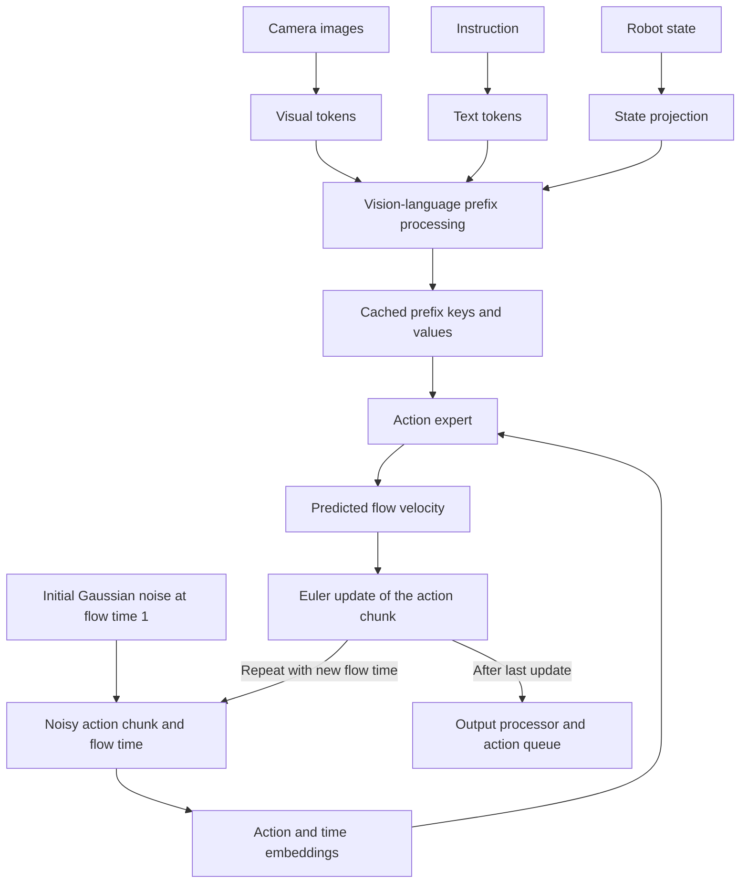
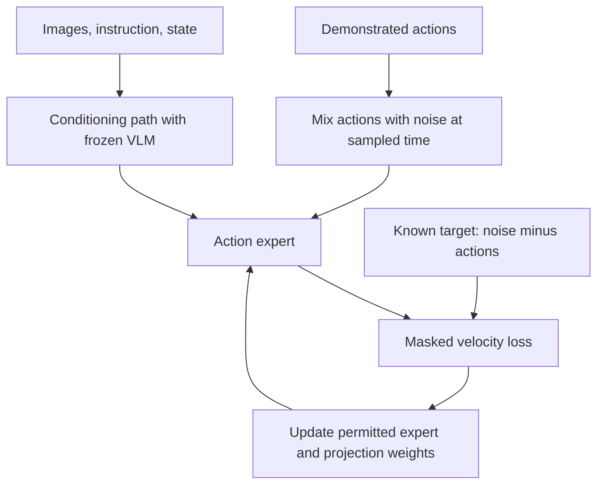

# SmolVLA: connect vision and language to action

[Concept guides](README.md) · [Control background](control-and-learning.md) · [Start Lesson 16](../16-smolvla-execution/16-smolvla-execution.ipynb)

## Why add language and a pretrained vision model?

An image can contain both a bowl and a plate. The instruction “put the bowl on the plate” specifies which behavior is wanted. A **vision-language model** (VLM) provides representations of images and text. A **vision-language-action model** (VLA) uses such information to generate robot actions. These names describe the inputs and outputs, not one mandatory action-generation algorithm.

The [SmolVLA paper](https://arxiv.org/abs/2506.01844) presents a VLA with a vision-language backbone and an action expert. In this course, a prepared checkpoint supplies both. The lessons expose input preparation, conditioning, flow training, sampling, and adaptation. They do not ask you to pretrain a vision-language backbone from scratch.

The VLM does not first write a textual plan that another policy translates into commands. Its internal features provide context to the action expert. The expert generates continuous action values. It does not generate a sentence describing an action.

## Follow the information through the model

Images become visual tokens. A tokenizer turns the instruction into integer token IDs, which become text embeddings. In the pinned course implementation, a projected robot-state token joins the image and text tokens in the **prefix**. The VLM processes this prefix. Its attention keys and values can be stored in a **cache**.

Separately, a noisy action chunk and a flow-time value become action tokens, called the **suffix**. The action expert reads the prefix context and these changing action tokens to predict a velocity field over the action chunk.

The cache avoids recomputing the same prefix during each flow update for one prediction. It belongs to that input context. When a new prediction uses a changed observation or prompt, build the corresponding prefix again. Caching is a computation choice; it does not make an old observation current.

## What flow matching learns

Like diffusion, flow matching learns to generate action chunks from noise. The specific training target and sampling rule differ. Here, training constructs a straight path between a demonstrated normalized action chunk `a` and Gaussian noise `epsilon`:

$$x_t=(1-t)a+t\varepsilon, \qquad u=\varepsilon-a.$$

The dimensionless **flow time** `t` runs from clean data at 0 to noise at 1. It is not seconds, a robot tick, or an action-slot index. The target `u` is the derivative of this constructed path with respect to `t`. The expert learns to predict it from `x_t`, `t`, and the observation context.

| Quantity | What it represents |
| --- | --- |
| `a` | Demonstrated action chunk, available during training |
| `x_t` | A mixture of that chunk and noise |
| `u` | Training velocity target for the constructed path |
| `v_theta(x_t, t, context)` | Learned velocity prediction |

“Velocity” here means the rate of change of the action tensor with respect to flow time. It is not the physical speed of the gripper. Some tensor channels represent rotation or gripper commands, so this distinction matters.

During inference, begin at `t = 1` with noise and integrate toward `t = 0`. The course uses Euler updates:

$$x_{\text{next}}=x+\Delta t\,v_\theta(x,t,c), \qquad \Delta t=-1/n.$$

`n` is the number of flow updates. The negative sign follows from moving from 1 down to 0. For a scalar example, take `a = 0.8` and `epsilon = -0.4`. The ideal target velocity is `-1.2`. With three updates and `dt = -1/3`, an exact constant velocity would add `0.4` each time: `-0.4`, then `0.0`, `0.4`, and `0.8`. In the learned model, the predicted velocity depends on the current point, time, and context, so it is evaluated again at each update.

The straight path is used to construct training pairs. A generated path through a learned field need not be a straight line. At inference, the clean target is unknown; it cannot be used to calculate `epsilon - a`.

## How this differs from the diffusion lessons

| Question | Course Diffusion Policy | Course SmolVLA |
| --- | --- | --- |
| What conditions generation? | Camera and state history | Vision-language prefix, including projected state |
| What does the network predict? | Added noise | Flow velocity |
| How is a training input made? | Noise schedule mixes signal and noise | Linear interpolation of actions and noise |
| What updates the sample? | DDPM scheduler coefficients and noise term | Euler step in the learned velocity field |
| What is generated? | An action window | An action chunk |

Both use repeated neural-network calls to produce actions from noise. Neither needs ACT to propose actions first. Their training losses are different quantities, so their raw values are not a model-quality ranking.

## What changes during adaptation?

The course freezes the VLM backbone. The optimizer updates the permitted action-expert and projection parameters. The exact trainable flags determine this set; a parameter that was already frozen stays frozen. Keeping the VLM in evaluation mode also keeps its training-mode behavior disabled.

A frozen backbone can provide useful representations, but its presence does not establish task competence. A changed prompt can alter predictions without producing the intended behavior. Test the policy in the stated task and keep that result separate from a conditioning probe.

The expert uses a common padded action width of 32. Only seven channels are real controller actions here. The other channels are excluded from the loss. Time padding near the end of an episode is a separate mask. Padded clean targets can be zero while their noisy counterparts contain noise; do not interpret every padded tensor entry as a robot command.

## Where each lesson fits

| Lesson | Component | Question to answer before coding |
| --- | --- | --- |
| [16: inputs](../16-smolvla-execution/16-smolvla-execution.ipynb) | Image preparation, tokenizer, state padding | What exact representation does the checkpoint expect? |
| [17: training](../17-smolvla-training/17-smolvla-training.ipynb) | Freeze rules and one flow update | Which weights can change, and what target trains them? |
| [18: conditioning](../18-smolvla-conditioning/18-smolvla-conditioning.ipynb) | Prefix, cache, and action/time route | How does a changed input reach the expert? |
| [19: flow](../19-smolvla-flow/19-smolvla-flow.ipynb) | Masked loss and Euler integration | How does one velocity prediction become a complete action sample? |
| [20: adaptation](../20-smolvla-adaptation/20-smolvla-adaptation.ipynb) | Fine-tuning, reload, and evaluation | Did the saved policy improve on separate data and rollouts? |

## Check your understanding

Can you send the expert's velocity output to `environment.step`? No. Complete flow integration, select the real action channels, use the output processor, and then execute the selected actions.

If a prompt changes the velocity, did the robot understand the instruction? The probe shows input sensitivity. Task performance needs a rollout test.

Exact course operations are in [smolvla.py](../../src/vla_lab/teaching/smolvla.py). The small numerical examples explain those operations; they are not demonstrations of a trained robot policy.
